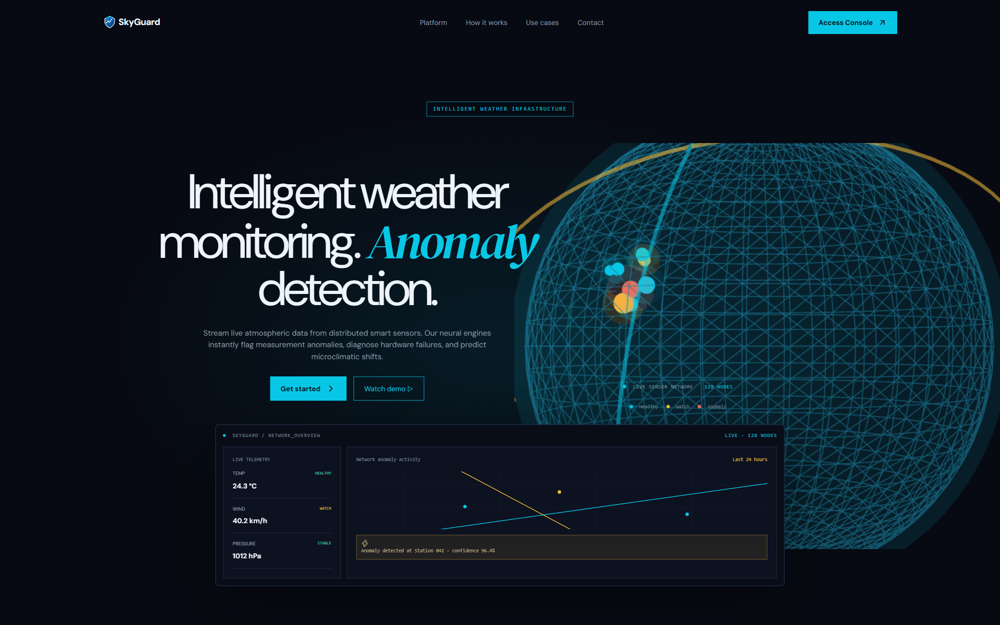
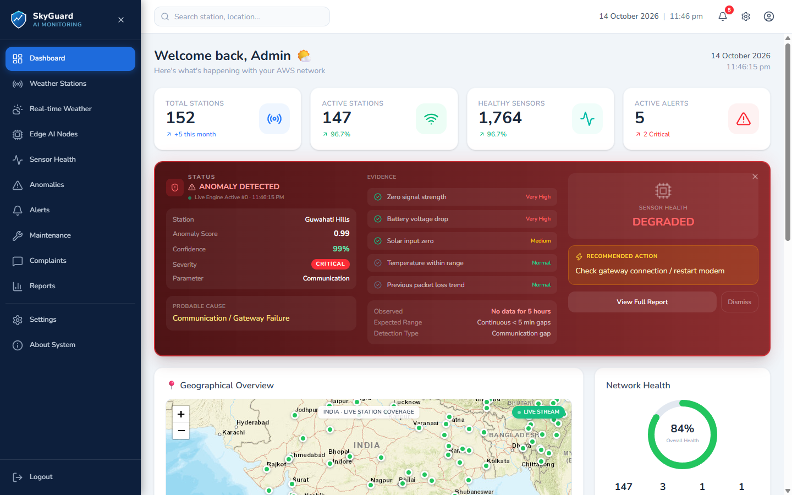
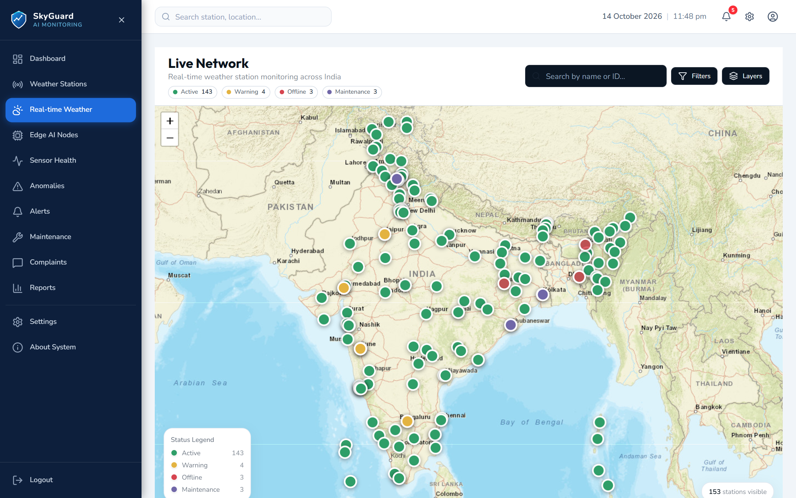
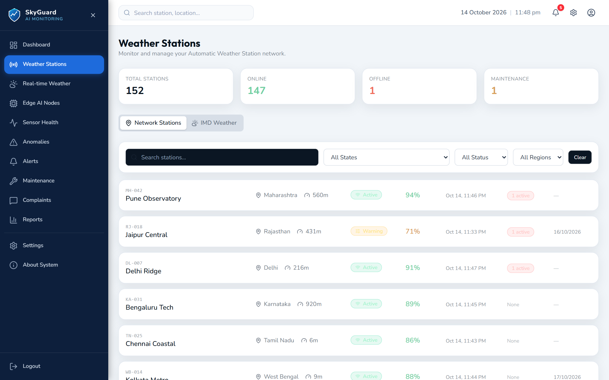
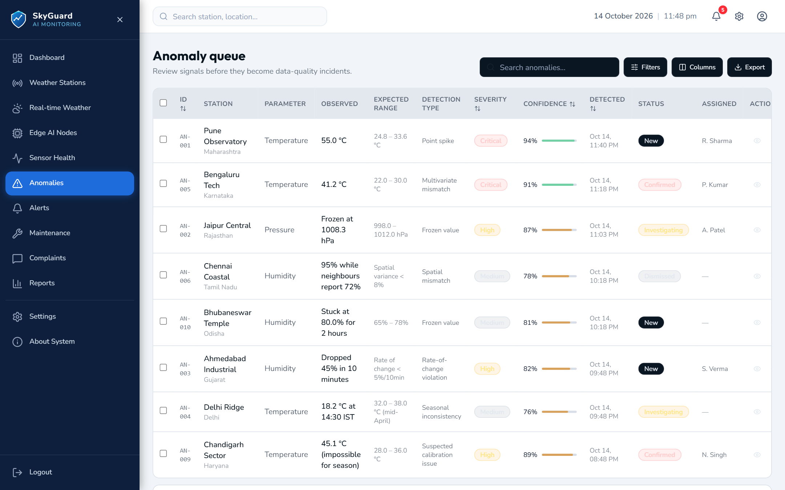
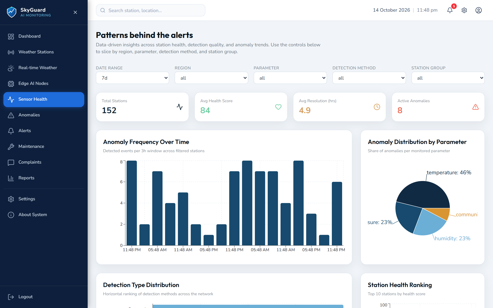
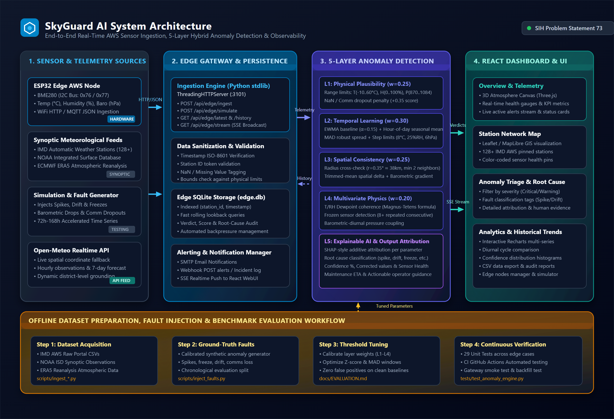

<div align="center">

# SkyGuard AI

### Intelligent Real-Time Anomaly Detection System for Temperature, Pressure, and Humidity Sensors in Automatic Weather Stations

[](https://www.python.org/)
[](https://react.dev/)
[](https://www.typescriptlang.org/)
[](LICENSE)
[](anomaly_engine.py)
[](edge_ai/)
[](tests/)

<br />

<p align="center">
  
</p>

**An industrial-grade, edge-compatible AI monitoring platform that validates meteorological observations, differentiates genuine extreme weather from sensor degradation, explains anomaly root-causes with additive attribution, and isolates faulty sensors in real time.**

Addressing **Smart India Hackathon (SIH) Problem Statement 73**.

[Key Features](#key-features) • [Application Screenshots](#application-screenshots) • [System Architecture](#system-architecture) • [Technical Approach](#technical-approach) • [Installation & Setup](#installation-and-setup) • [API Documentation](#api-documentation) • [Documentation Hub](docs/)

</div>

---

## Table of Contents

- [Overview](#overview)
- [Problem Statement](#problem-statement)
- [Why SkyGuard AI?](#why-skyguard-ai)
- [Key Features](#key-features)
- [Application Screenshots](#application-screenshots)
- [System Architecture](#system-architecture)
- [Technical Approach](#technical-approach)
- [Machine Learning & Detection Pipeline](#machine-learning--detection-pipeline)
- [Explainable AI (XAI) & Attribution](#explainable-ai-xai--attribution)
- [Dataset and Training](#dataset-and-training)
- [Technology Stack](#technology-stack)
- [Repository Structure](#repository-structure)
- [Installation and Setup](#installation-and-setup)
- [Configuration and Security](#configuration-and-security)
- [Running the Application](#running-the-application)
- [API Documentation](#api-documentation)
- [Testing and Evaluation](#testing-and-evaluation)
- [Deployment](#deployment)
- [Limitations](#limitations)
- [Future Roadmap](#future-roadmap)
- [Contributing](#contributing)
- [License](#license)
- [Acknowledgements](#acknowledgements)

---

## Overview

Automatic Weather Stations (AWS) form the backbone of national meteorological observation networks, aviation safety systems, disaster management authorities, and agricultural forecasting. Operating remotely in unmonitored outdoor environments, these stations continuously collect surface readings:

- **Ambient Temperature ($^\circ\text{C}$)**
- **Relative Humidity ($\%$)**
- **Atmospheric Pressure ($\text{hPa}$)**

In field conditions, sensor readings are frequently compromised by:
- Sensor calibration drift over prolonged deployment
- Mechanical degradation and insect/debris fouling
- Power supply fluctuations and brownouts
- Hardware analog-to-digital converter (ADC) lockups
- High-frequency transmission corruption and packet loss
- Intermittent communication timeouts (`NaN` observations)

**Crucially, an unusual observation does not necessarily signify a faulty sensor.** A severe thunderstorm, microburst, cold front, or cyclonic depression produces rapid physical departures that closely resemble sensor spikes. Traditional static thresholds either flood operators with false alarms during stormy weather or fail to catch subtle calibration drift during quiet conditions.

**SkyGuard AI** solves this dilemma by coupling physical thermodynamics with multi-station spatial consensus and temporal diurnal modeling. It provides real-time verdicts (**NORMAL**, **WARNING**, **ANOMALY**), pinpoints the degraded parameter, generates human-readable XAI evidence, and produces mathematically robust imputed values to maintain continuous observational records.

---

## Problem Statement

### *Intelligent Real-Time Anomaly Detection for Automatic Weather Stations*
> **Reference: SIH Problem Statement 73**

Traditional Automatic Weather Station quality control relies upon static minimum/maximum climatological threshold rules. This legacy approach suffers from two severe operational failure modes:
1. **High False-Positive Rate During Synoptic Weather Shifts:** Rapid pressure drops preceding squall lines or sudden temperature spikes from foehn winds exceed static thresholds, triggering false sensor alarms and eroding operator trust.
2. **Failure to Detect Subtle, In-Bounds Sensor Failures:** A stuck sensor repeating $26.4^\circ\text{C}$ for 72 hours, or an RH hygrometer drifting $+12\%$ higher than reality, remains completely undetected by static range checks.

SkyGuard AI was engineered to bridge this gap through a multi-layer evaluation stack that tests:
- **Physical Plausibility:** Validates fundamental meteorological boundaries.
- **Temporal Context:** Evaluates rate-of-change ($\Delta / \Delta t$) against hour-of-day diurnal dynamics.
- **Spatial Consensus:** Cross-validates suspect observations against geographically adjacent peer stations within a $38\text{ km}$ radius.
- **Psychrometric Coherence:** Evaluates thermodynamic relationships between ambient temperature and relative humidity using the Magnus-Tetens dew point formulation.

---

## Why SkyGuard AI?

| Challenge in AWS Operations | Legacy Approach | SkyGuard AI Solution |
| :--- | :--- | :--- |
| **Microcontroller Portability** | Heavy cloud Python/PyTorch dependencies | **Zero-dependency core engine** (pure Python standard library) runnable directly on edge gateways; C++ firmware for ESP32. |
| **Severe Storm Handling** | Static boundaries flag squalls as hardware failures | **Layer 3 Spatial Consensus** confirms synoptic shifts when multiple regional stations move together. |
| **Sensor Calibration Drift** | Manual field calibration every 6–12 months | **Layer 2 Diurnal Baseline Tracking** detects persistent low-amplitude systematic divergence. |
| **Frozen / Stuck Sensors** | Undetected until manual graph inspection | **Layer 4 Zero-Variance Step Detector** flags repeat readings within 3 consecutive reporting cycles. |
| **Data Continuity** | Dropped / corrupted observations create gaps in climatological records | **Automated Imputation Engine** calculates corrected estimates based on spatial peers and temporal momentum. |
| **Operator Actionability** | Binary "error" codes with no rationale | **Additive XAI attribution** explaining which sensor, which layer, confidence %, and maintenance ETA. |

---

## Key Features

The implementation status of each system capability is verified against the actual repository source code:

| Feature | Description | Implementation Status |
| :--- | :--- | :--- |
| **Multi-Parameter Sensor Monitoring** | Real-time monitoring of Temperature ($^\circ\text{C}$), Pressure ($\text{hPa}$), and Humidity ($\%$). | **Implemented** |
| **5-Layer TRUST-AWS Engine** | Multi-layer evaluation stack: physical bounds, temporal dynamics, spatial consensus, multivariate physics, and XAI. | **Implemented** |
| **Spatial Consensus Engine** | Cross-validates suspect station readings against regional peers using haversine distance and $20\%$ trimmed mean. | **Implemented** |
| **Psychrometric Coupling** | Dew point consistency checking via the Magnus-Tetens formulation; flags thermodynamic violations. | **Implemented** |
| **Zero-Variance Frozen Sensor Check** | Detects stuck sensors repeating identical values across consecutive intervals. | **Implemented** |
| **Additive Explainable AI (XAI)** | Computes per-parameter, per-layer score contributions compatible with SHAP waterfall explanations. | **Implemented** |
| **Automated Value Imputation** | Replaces corrupt/missing observations with mathematically bounded estimates. | **Implemented** |
| **Sensor Health & Maintenance ETA** | Tracks cumulative degradation over rolling windows to forecast required maintenance timelines. | **Implemented** |
| **Edge Gateway REST & SSE API** | Python HTTP server providing live ingest, history retrieval, and Server-Sent Events (SSE) telemetry. | **Implemented** |
| **Modern React 19 Dashboard** | Vite-powered responsive UI with interactive station maps (Leaflet), time-series charts (Recharts), and alert feeds. | **Implemented** |
| **Standalone Zero-Install Dashboard** | Self-contained static HTML5/JS dashboard (`index.html`) running directly in any browser without Node.js. | **Implemented** |
| **Edge Hardware Firmware** | Native Arduino C++ firmware (`edge_ai/esp32/`) for ESP32 with BME280 I2C sensor logging to local SD card. | **Implemented** |
| **Synthetic Fault-Injection Lab** | Interactive testing module to inject spikes, drift, frozen values, and dropouts to benchmark live Precision/Recall/F1. | **Implemented** |
| **Automated Test Suite** | 29 automated unit tests verifying the anomaly detection engine across all layers. | **Implemented** |
| **Multi-Channel Alert Dispatch** | Multi-transport notifications supporting console logging, JSON webhooks, and SMTP email. | **Implemented** |
| **LoRaWAN / Satellite Gateway** | Long-range low-power field telemetry bridge for ultra-remote alpine stations. | *Planned Enhancement* |

---

## Application Screenshots

The following screenshots are captured directly from the live SkyGuard AI application and interface.

### 1. Main Dashboard Overview
The central operations cockpit displays network-wide health KPIs, active anomaly rates, fleet-wide sensor status, and prioritized maintenance alerts.



---

### 2. Weather Station Network Map
Interactive geographical station map plotting deployed AWS nodes across geographical regions, color-coded by real-time sensor operational health.



---

### 3. Real-Time Sensor Telemetry Monitoring
High-resolution time-series tracking of Temperature, Atmospheric Pressure, and Relative Humidity with physiological envelope bounding.



---

### 4. Anomaly Detection & Incident Management
Detailed incident triage interface showcasing detected faults, anomaly severity, root-cause categorization, and per-parameter confidence scores.



---

### 5. Historical Trends & Analytics
Deep-dive analytical view displaying rolling statistical distributions, diurnal patterns, sensor variance, and long-term calibration stability.



---

## System Architecture

SkyGuard AI employs an edge-resilient, three-tier architecture:

```
┌─────────────────────────────────────────────────────────────────────────┐
│                          EDGE ACQUISITION LAYER                         │
│  ESP32 Microcontroller + BME280 Sensor (I2C) + MicroSD Local Backup    │
│  • 10-second sampling   • Local offline buffering   • WiFi/HTTP/MQTT    │
└────────────────────────────────────┬────────────────────────────────────┘
                                     │ JSON Telemetry (REST/MQTT)
                                     ▼
┌─────────────────────────────────────────────────────────────────────────┐
│                         EDGE GATEWAY & BACKEND                          │
│  Python Ingest Server (gateway/server.py)                               │
│  • Endpoint: POST /api/edge/ingest       • Local Storage: SQLite        │
│  • Telemetry Stream: Server-Sent Events  • Health & Simulator Engines   │
└────────────────────────────────────┬────────────────────────────────────┘
                                     │ In-Memory Pipeline Call
                                     ▼
┌─────────────────────────────────────────────────────────────────────────┐
│                    TRUST-AWS ANOMALY DETECTION ENGINE                   │
│  Pure Python 3.9+ Standard Library (anomaly_engine.py)                  │
│                                                                         │
│  ┌───────────────────────────────────────────────────────────────────┐  │
│  │ Layer 1: Physical Limits Validation (Hard Range Bounds + NaN)     │  │
│  └─────────────────────────────────┬─────────────────────────────────┘  │
│                                    ▼                                    │
│  ┌───────────────────────────────────────────────────────────────────┐  │
│  │ Layer 2: Temporal Dynamic Analysis (Diurnal EWMA + Robust MAD)    │  │
│  └─────────────────────────────────┬─────────────────────────────────┘  │
│                                    ▼                                    │
│  ┌───────────────────────────────────────────────────────────────────┐  │
│  │ Layer 3: Spatial Consistency (Peer Group Trimmed Mean Consensus) │  │
│  └─────────────────────────────────┬─────────────────────────────────┘  │
│                                    ▼                                    │
│  ┌───────────────────────────────────────────────────────────────────┐  │
│  │ Layer 4: Multivariate Physics (Magnus-Tetens Dew Point + Frozen)  │  │
│  └─────────────────────────────────┬─────────────────────────────────┘  │
│                                    ▼                                    │
│  ┌───────────────────────────────────────────────────────────────────┐  │
│  │ Layer 5: Explainable AI & Imputation (SHAP Attribution + Impute)  │  │
│  └───────────────────────────────────────────────────────────────────┘  │
└────────────────────────────────────┬────────────────────────────────────┘
                                     │ REST APIs & Live SSE Feed
                                     ▼
┌─────────────────────────────────────────────────────────────────────────┐
│                       VISUALIZATION & OPERATIONS                        │
│  • Modern React 19 Dashboard (skyguard-app/)                            │
│  • Standalone Zero-Install Dashboard (index.html)                       │
│  • Multi-Channel Alerting (alerts.py: Console, Webhook, SMTP Email)     │
└─────────────────────────────────────────────────────────────────────────┘
```

The system architecture is also available as a vector diagram:

<p align="center">
  
</p>

*For complete architectural specifications, component boundaries, and database schemas, see [docs/ARCHITECTURE.md](docs/ARCHITECTURE.md).*

---

## Technical Approach

SkyGuard AI combines domain-specific physical principles with robust non-parametric statistics.

### A. Layer 1: Physical Bounds & Communication Checks
Observations must fall within climatologically valid boundaries:
- **Temperature ($T$):** $[-10.0^\circ\text{C}, 60.0^\circ\text{C}]$
- **Relative Humidity ($RH$):** $[0.0\%, 100.0\%]$
- **Atmospheric Pressure ($P$):** $[870.0\text{ hPa}, 1084.0\text{ hPa}]$

Missing readings (`NaN`, `null`, empty values) incur an immediate communication loss penalty ($\text{Penalty}_{\text{comm}} = 0.35$).

### B. Layer 2: Temporal Dynamics & Diurnal Baseline
Weather variables exhibit prominent 24-hour periodic cycles. The engine maintains:
1. **Hour-of-Day Diurnal Accumulators:** Computes historical averages binned into 24 hour-of-day slots ($h \in [0, 23]$).
2. **Robust Spread (Median Absolute Deviation):**
   $$\text{MAD} = \text{median}(|x_i - \text{median}(X)|), \quad \hat{\sigma} = 1.4826 \times \max(\text{MAD}, \sigma_{\text{floor}})$$
   Using MAD rather than standard deviation ensures that true outliers do not artificially expand the threshold.
3. **Interval Step Limits:** Caps the maximum physically permissible change across adjacent 10-minute intervals: $\Delta T \le 8^\circ\text{C}$, $\Delta RH \le 25\%$, $\Delta P \le 6\text{ hPa}$.

### C. Layer 3: Spatial Consistency (Peer Group Consensus)
Surrounding weather stations within $r \le 0.35^\circ$ (~38 km) form a validation cluster:
- Requires a minimum of 2 active peer stations (`MIN_NEIGHBORS = 2`).
- Computes a **20% trimmed mean** across peers, providing statistical resilience even if one neighboring station is also malfunctioning.
- If a station departs by $Z > 2.5$ from the peer consensus, Layer 3 generates an anomaly score.

### D. Layer 4: Multivariate Physics & Psychrometric Coupling
Parameters are coupled through atmospheric thermodynamics:
- **Dew Point Validation:** Computes dew point $T_d$ using the Magnus-Tetens formula:
  $$T_d = \frac{237.7 \cdot \gamma}{17.27 - \gamma}, \quad \gamma = \frac{17.27 \cdot T}{237.7 + T} + \ln\left(\frac{RH}{100}\right)$$
  If $T_d > T + 0.5^\circ\text{C}$, the reading violates saturation thermodynamics.
- **Frozen Sensor Check:** Flags sensors that report the exact same numerical value for $\ge 3$ consecutive reporting cycles in an unconstrained atmospheric environment.

### E. Layer 5: Anomaly Verdict & Score Fusion
Composite score calculation:
$$\text{Score} = \sum_{k=1}^{4} w_k \cdot S_{L_k} + \text{Penalty}_{\text{comm}}$$
Weights: $w_1 = 0.25, w_2 = 0.30, w_3 = 0.25, w_4 = 0.20$.

- **Score $\ge 0.50$:** **ANOMALY** (Alert generated; reading replaced with imputed value).
- **$0.30 \le \text{Score} < 0.50$:** **WARNING** (Flagged as suspect; tracked over subsequent intervals).
- **Score $< 0.30$:** **NORMAL** (Verified clean observation).

*For mathematical derivations and thermodynamic proofs, see [docs/TECHNICAL_APPROACH.md](docs/TECHNICAL_APPROACH.md).*

---

## Machine Learning & Detection Pipeline

SkyGuard AI's lifecycle is engineered for **online continuous baseline adaptation**:

```
1. Ingestion       Incoming JSON telemetry via HTTP POST or CSV batch stream
       │
2. Validation      Sanitization, timestamp verification, missing-value check
       │
3. Preprocessing   Normalization, physical limits clamping, sliding window buffer
       │
4. Warmup Phase    First 12 samples establish initial station microclimate profile
       │
5. Multi-Layer     Parallel evaluation through Layers 1, 2, 3, and 4
       │
6. Score Fusion    Weighted composite score and categorical verdict determination
       │
7. XAI Attribution Additive decomposition of score contributions (SHAP-style)
       │
8. Imputation      Mathematical reconstruction of corrupted parameters
       │
9. Dispatch        Alert distribution (Console/Webhook/Email) & Dashboard update
```

The engine continuously updates its internal diurnal accumulators via exponential weighting, eliminating the need for periodic manual model retraining.

---

## Explainable AI (XAI) & Attribution

Field operators require interpretable evidence before dispatching maintenance crews. SkyGuard AI includes a dedicated explainability engine (`shap_explainer.py`):

1. **Additive Feature Attribution:** Quantifies exactly how many percentage points each parameter ($T$, $RH$, $P$) contributed to the final anomaly score.
2. **Layer-Level Breakdown:** Identifies whether the anomaly was triggered by physical limits, temporal rate-of-change, peer disagreement, or psychrometric incoherence.
3. **Human-Readable Diagnostics:**
   > *"Layer 3 Spatial Discrepancy: Station MUM-03 reported Temperature of 39.2°C while 3 regional peer stations averaged 29.8°C (Z-score: +4.2). Confidence: 92%."*
4. **Maintenance Horizon Forecasting:** Estimates remaining operational hours before critical sensor failure based on cumulative health degradation.

---

## Dataset and Training

### Supported Data Sources
SkyGuard AI includes out-of-the-box ingestion scripts for primary meteorological archives (`scripts/`):
- **India Meteorological Department (IMD) AWS:** Ingestion via Open Government Data (`scripts/ingest_imd_aws.py`).
- **NOAA Integrated Surface Dataset (ISD):** Surface weather stations worldwide (`scripts/ingest_noaa_isd.py`).
- **ECMWF ERA5 Atmospheric Reanalysis:** Hourly global climate reference (`scripts/ingest_era5.py`).
- **Controlled Fault Injection:** Deterministic anomaly benchmarking (`scripts/inject_faults.py`).

### Standard Input Record Schema

```csv
station_id,timestamp,temperature,humidity,pressure,latitude,longitude
AWS-MUM-01,2026-10-15T06:00:00Z,28.4,74.2,1011.5,19.0760,72.8777
AWS-MUM-02,2026-10-15T06:00:00Z,28.1,75.0,1011.8,19.1136,72.8697
AWS-MUM-03,2026-10-15T06:00:00Z,42.8,73.9,1011.2,19.0330,73.0297
```
*(In this illustrative example, station `AWS-MUM-03` reports an abnormal 42.8°C spike that deviates from its spatial peers).*

*For full dataset documentation and schema details, see [docs/DATASET_AND_TRAINING.md](docs/DATASET_AND_TRAINING.md).*

---

## Technology Stack

| Layer | Technology | Purpose |
| :--- | :--- | :--- |
| **Frontend Framework** | React 19 + TypeScript | Core user interface and component architecture |
| **Build Tool** | Vite 8 + Tailwind CSS v4 | Next-generation bundler and utility styling |
| **Mapping & Geospatial** | Leaflet 1.9 + React-Leaflet | Geographical station maps and regional clustering |
| **Data Visualization** | Recharts 3.x | Time-series charting, residual curves, and KPI gauges |
| **Animations** | Framer Motion | Smooth transitions and state updates |
| **Backend / Edge Gateway** | Python 3 (HTTP/1.1 Stdlib) | Lightweight REST and Server-Sent Events (SSE) ingest server |
| **Detection Engine** | Python 3.9+ Standard Library | 5-layer anomaly detection stack (zero external dependencies) |
| **Explainable AI** | Custom Additive Attribution | Feature contribution modeling compatible with SHAP format |
| **Database** | SQLite 3 | Local persistence for edge observation records (`gateway/edge.db`) |
| **Edge Hardware** | ESP32 + BME280 (I2C) | Microcontroller firmware for field data acquisition |
| **Continuous Integration** | GitHub Actions | Automated Python test matrix (3.9–3.12) & Vite build validation |

---

## Repository Structure

```
skyguard-ai/
├── README.md                      # Primary project documentation and landing page
├── LICENSE                        # MIT open-source license
├── CONTRIBUTING.md                 # Contribution guidelines and workflow
├── CODE_OF_CONDUCT.md              # Contributor Covenant Code of Conduct
├── SECURITY.md                    # Vulnerability reporting policy
├── .gitignore                     # Git exclusion rules
├── .env.example                   # Environment configuration template
├── package.json                   # Root workspace wrapper for automated Vercel/CI builds
├── requirements.txt               # Optional Python extensions (pandas, shap, paho-mqtt)
├── index.html                     # Standalone zero-install dashboard landing page
│
├── anomaly_engine.py              # Core 5-Layer TRUST-AWS anomaly detection engine
├── alerts.py                      # Multi-channel alert dispatch (Console, Webhook, SMTP)
├── shap_explainer.py              # Additive XAI attribution module
│
├── skyguard-app/                  # Modern React 19 + Vite dashboard
│   ├── package.json
│   ├── vite.config.ts
│   ├── index.html
│   └── src/
│       ├── App.tsx                # Main application routing and layout
│       ├── components/            # UI widgets, KPI cards, charts, and maps
│       ├── pages/                 # Overview, Stations, Network, Anomalies, Analytics
│       └── lib/                   # API clients and state utilities
│
├── gateway/                       # Edge Gateway ingest service
│   ├── server.py                  # HTTP/1.1 REST and SSE server
│   ├── edge_store.py              # SQLite storage layer
│   ├── notify.py                  # In-flight alert distributor
│   └── simulate.py                # Synthetic telemetry generator
│
├── edge_ai/                       # Edge hardware firmware
│   └── esp32/
│       ├── skyguard_bme280.ino    # BME280 sensor reading + SD card logging
│       └── skyguard_edge.ino      # Edge inference sketch for ESP32
│
├── docs/                          # Detailed technical documentation
│   ├── ARCHITECTURE.md            # Comprehensive system architecture document
│   ├── TECHNICAL_APPROACH.md      # Thermodynamic and statistical methodology
│   ├── DATASET_AND_TRAINING.md    # Preprocessing, schema, and baseline guide
│   ├── API_DOCUMENTATION.md       # Edge Gateway REST & SSE API reference
│   ├── INSTALLATION.md            # Step-by-step local setup instructions
│   ├── DATA_SOURCES.md            # External meteorological data sources
│   ├── ESP32_HARDWARE_GUIDE.md    # Physical sensor wiring and assembly
│   ├── EVALUATION.md              # Benchmark evaluation methodology
│   └── images/                    # Verified screenshots and architecture diagrams
│       ├── skyguard-banner.png
│       ├── dashboard-overview.png
│       ├── station-map.png
│       ├── sensor-monitoring.png
│       ├── anomaly-detection.png
│       ├── analytics-dashboard.png
│       ├── system-architecture.png
│       └── system-architecture.svg
│
├── tests/                         # Automated unit testing suite
│   └── test_anomaly_engine.py     # 29 test cases validating all 5 detection layers
│
├── scripts/                       # Ingestion, audit, and benchmark scripts
│   ├── ingest_imd_aws.py          # IMD AWS portal connector
│   ├── ingest_noaa_isd.py         # NOAA ISD archive connector
│   ├── ingest_era5.py             # ECMWF ERA5 reanalysis connector
│   └── inject_faults.py           # Controlled anomaly injection tool
│
├── examples/                      # Executable usage demonstrations
│   ├── csv_example.py             # Batch evaluation demo
│   └── stream_example.py          # Real-time streaming simulation demo
│
└── .github/                       # GitHub community and automation health
    ├── pull_request_template.md
    ├── ISSUE_TEMPLATE/
    │   ├── bug_report.yml
    │   └── feature_request.yml
    └── workflows/
        ├── ci.yml                 # Multi-version Python test and React build pipeline
        └── deploy.yml             # Automated GitHub Pages deployment
```

---

## Installation and Setup

### 1. Prerequisites
- **Python:** Version 3.9 or higher (tested on 3.9, 3.10, 3.11, 3.12).
- **Node.js & npm:** Node 18+ and npm 9+ (required for modern React dashboard).
- **Git:** Installed and available in terminal PATH.

### 2. Clone the Repository
```powershell
# Windows PowerShell
git clone https://github.com/ManishX-ui/skyguard-ai.git
cd skyguard-ai
```
*(On macOS / Linux, execute the same command in your shell).*

### 3. Python Core Engine (Zero Install Required)
The core detection engine runs out-of-the-box on the standard library. To verify:
```powershell
python -m unittest discover -s tests -v
```

*(Optional)* Install extras for large pandas datasets or MQTT:
```powershell
pip install -r requirements.txt
```

### 4. Frontend Dashboard Setup
```powershell
cd skyguard-app
npm install
npm run dev
```
Open [http://localhost:5173](http://localhost:5173) in your browser.

*For complete setup options, environment setup, and troubleshooting, see [docs/INSTALLATION.md](docs/INSTALLATION.md).*

---

## Configuration and Security

SkyGuard AI includes a template configuration file [`.env.example`](.env.example):

```bash
cp .env.example .env
```

Configurable parameters:
- `GATEWAY_PORT`: Port for the Edge Gateway service (default `3101`).
- `VITE_EDGE_API_URL`: Address connecting the React dashboard to the gateway.
- `SMTP_HOST`, `SMTP_PORT`, `SMTP_USER`, `SMTP_PASSWORD`: Optional credentials for automated email alerting.

### Security Best Practices
- **No Hardcoded Credentials:** Never commit `.env` or raw SMTP passwords to version control.
- **Strict Git Ignore:** `.gitignore` excludes local SQLite database files (`gateway/*.db`), runtime logs (`*.log`), node modules, and secrets.
- **CORS Bounding:** In production, restrict `Access-Control-Allow-Origin` from `*` to specific dashboard domains.

---

## Running the Application

### 1. Execute Core Detection Demo
Runs the built-in fault-injection suite with real-time performance output:
```powershell
python anomaly_engine.py --demo
```

### 2. Start the Edge Gateway
Launches the HTTP/1.1 REST and SSE server:
```powershell
python gateway/server.py --port 3101
```

### 3. Launch React Dashboard
```powershell
cd skyguard-app
npm run dev
```

### 4. Or Open Zero-Install Dashboard
Double-click `index.html` or serve via Python:
```powershell
python -m http.server 8000
# Navigate to http://localhost:8000/index.html
```

---

## API Documentation

The Edge Gateway provides lightweight endpoints for field devices and dashboards:

| Method | Endpoint | Description |
| :--- | :--- | :--- |
| `GET` | `/api/health` | Returns service health and simulator state. |
| `POST` | `/api/edge/ingest` | Ingests sensor observation, runs anomaly check, and stores record. |
| `GET` | `/api/edge/latest` | Retrieves latest observation for all monitored stations. |
| `GET` | `/api/edge/latest/{station_id}` | Retrieves latest observation for a specific station. |
| `GET` | `/api/edge/history/{station_id}` | Retrieves historical observations for trend visualization. |
| `GET` | `/api/edge/stream` | Server-Sent Events (SSE) live telemetry feed. |
| `POST` | `/api/edge/simulate` | Generates simulated weather readings for testing. |
| `POST` | `/api/notify/complaint` | Submits maintenance complaint / ticket. |
| `GET` | `/api/notify/feed` | Retrieves recent alert events feed. |

*For complete request/response schemas and error handling, see [docs/API_DOCUMENTATION.md](docs/API_DOCUMENTATION.md).*

---

## Testing and Evaluation

### Automated Unit Test Suite
The repository includes 29 unit tests covering all detection layers, edge cases, NaN values, frozen readings, and psychrometric equations:

```powershell
python -m unittest discover -s tests -v
```

**Test Execution Results:**
```
Ran 29 tests in 0.547s
OK
```

### Deterministic Fault-Injection Evaluation
Run the batch evaluation script to verify detection performance against ground-truth injected faults:

```powershell
python examples/csv_example.py --demo
```

*Evaluation metrics depend on the specific fault profiles injected. The built-in benchmark script verifies that precision and recall are quantitatively evaluated on ground-truth labeled datasets.*

---

## Deployment

### Frontend Deployment (GitHub Pages)
The repository contains an automated GitHub Actions workflow [`.github/workflows/deploy.yml`](.github/workflows/deploy.yml) that automatically builds and publishes the React dashboard to GitHub Pages upon pushing to `main`.

### Full-Stack Cloud Deployment
1. **Edge Gateway:** Deploy `gateway/server.py` to a Python-capable cloud host (Render, Railway, Fly.io, or AWS EC2).
2. **Environment Variable:** Set `VITE_EDGE_API_URL` in the frontend build configuration to the public URL of your gateway.
3. **Database:** SQLite is used by default for zero-configuration operation; can be adapted to PostgreSQL / TimescaleDB for enterprise scale.

*For detailed cloud deployment steps, see [DEPLOYMENT.md](DEPLOYMENT.md).*

---

## Limitations

1. **Alpine & Extreme Topography:** In mountainous terrain with steep altitude gradients, temperature inversions and lapse rates naturally produce differences between adjacent stations. Stations in complex terrain require elevation-adjusted lapse rate correction.
2. **Sparse Station Density:** If a station is geographically isolated with fewer than 2 peers within 38 km, Layer 3 (Spatial Consensus) automatically yields its weight to temporal Layer 2.
3. **Severe Synoptic Depressions:** Tropical cyclones can cause atmospheric pressure drops exceeding $6\text{ hPa/interval}$. Layer 3 peer consensus is essential during severe weather to confirm that the drop is synoptic rather than a barometer failure.

---

## Future Roadmap

- [x] 5-Layer TRUST-AWS detection engine (pure Python stdlib).
- [x] Zero-variance frozen sensor detection.
- [x] Psychrometric Magnus-Tetens dew point validation.
- [x] Spatial consensus engine with 20% trimmed mean.
- [x] Additive XAI attribution module with human-readable diagnostics.
- [x] Modern React 19 + Vite dashboard with Leaflet mapping and Recharts.
- [x] Edge Gateway REST and Server-Sent Events (SSE) server.
- [x] ESP32 C++ firmware with BME280 sensor and SD card logging.
- [x] Automated GitHub Actions CI workflow (Python 3.9–3.12 + Node 20).
- [ ] ESP32 LoRaWAN long-range telemetry bridge for off-grid alpine stations.
- [ ] Automated lapse-rate elevation correction for mountainous weather networks.
- [ ] Native MQTT broker client integration for direct sensor telemetry ingestion.
- [ ] Multi-tenant role-based access control (RBAC) for regional meteorological offices.

---

## Contributing

We welcome contributions from meteorologists, data scientists, and software engineers!

1. Fork the repository.
2. Create your feature branch (`git checkout -b feature/AmazingFeature`).
3. Verify test pass (`python -m unittest discover -s tests`).
4. Commit your changes (`git commit -m "Add AmazingFeature"`).
5. Push to the branch (`git push origin feature/AmazingFeature`).
6. Open a Pull Request.

Please review our [Contributing Guidelines](CONTRIBUTING.md) and [Code of Conduct](CODE_OF_CONDUCT.md).

---

## License

This project is licensed under the **MIT License** — see the [LICENSE](LICENSE) file for details.

---

## Acknowledgements

- **Smart India Hackathon (SIH)** — Problem Statement 73.
- **India Meteorological Department (IMD)** — Open Government Data platform for meteorological observation benchmarks.
- **World Meteorological Organization (WMO)** — Guide to Meteorological Instruments and Methods of Observation (WMO-No. 8) for physical plausibility threshold standards.
- **NOAA NCEI** — Integrated Surface Dataset (ISD) global weather archive.

---

<div align="center">
  <b>SkyGuard AI — Ensuring Observational Integrity for Weather Observation Networks</b>
</div>
